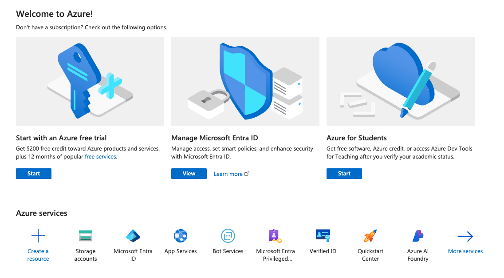
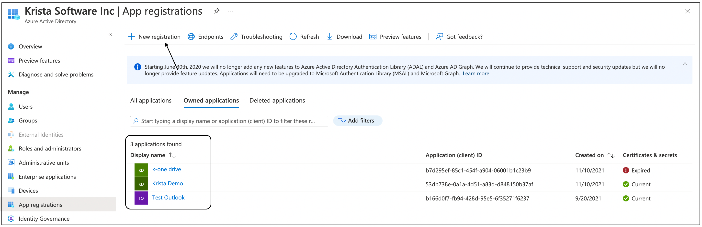
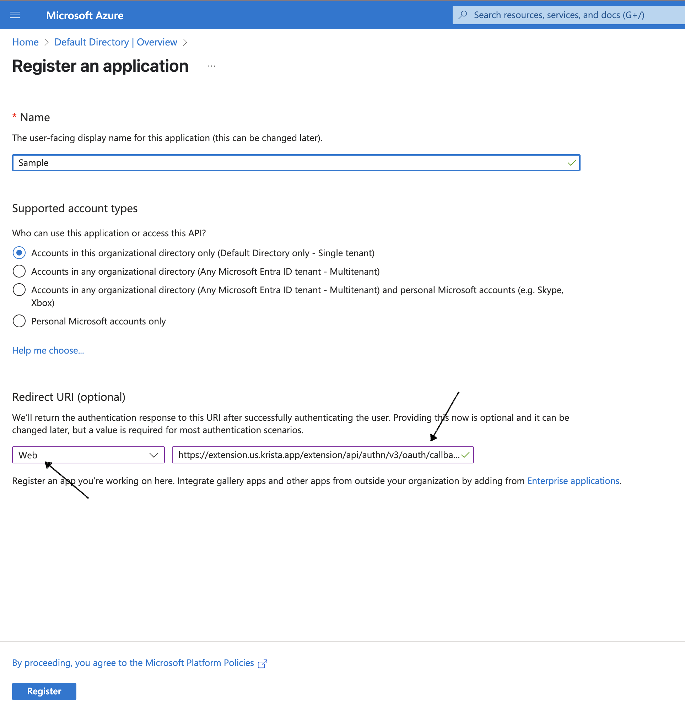
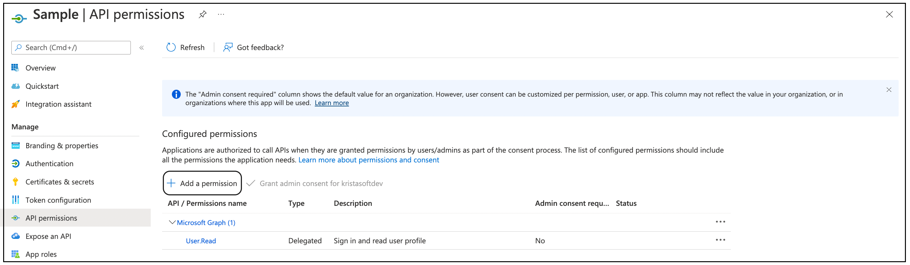
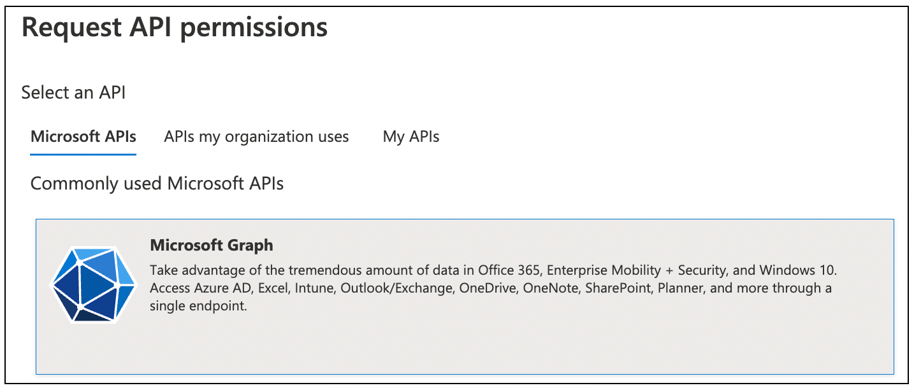

# Creating Azure App

## Overview

To use the Azure Authentication Extension, you must create an application registration in the Microsoft Azure Portal. This application registration provides the necessary credentials (Client ID, Client Secret, and Tenant ID) and configures the required permissions for OAuth 2.0 authentication with Microsoft Entra ID.

## Prerequisites

Before creating your Azure app registration, ensure you have:
- [ ] Microsoft Azure subscription
- [ ] Access to Microsoft Entra ID (Azure Active Directory)
- [ ] Sufficient permissions to create app registrations
- [ ] Administrative access to grant permissions (if required)

## Step-by-Step Instructions

### 1. Access Azure Portal

1. Navigate to the [Azure Portal](https://portal.azure.com/)
2. Sign in with your Microsoft credentials
3. Ensure you're in the correct Azure directory/tenant



### 2. Navigate to Microsoft Entra ID

1. In the Azure Portal home page, locate **Azure services**
2. Click on **Microsoft Entra ID**
3. If not visible, click **More services** and search for "Microsoft Entra ID"


> **📝 Note**: Microsoft Entra ID was formerly known as Azure Active Directory (Azure AD).

### 3. Access App Registrations

1. In the Microsoft Entra ID overview page, locate the **Manage** section in the left navigation
2. Click on **App registrations**
3. This will display all existing app registrations in your tenant


### 4. Create New Registration

1. At the top of the App registrations page, click **+ New registration**
2. Alternatively, if you have an existing application, you can select it instead



### 5. Configure Application Registration

On the **Register an application** page, provide the following information:

#### Application Name
- Enter a descriptive name for your application
- Example: "Krista Azure Authentication Extension"
- This name will be displayed to users during consent

#### Supported Account Types
Select the appropriate account type for your organization:
- **✅ Recommended**: "Accounts in this organizational directory only (Single tenant)"
- This option provides the highest security for enterprise environments
- Only users from your Azure tenant can authenticate

#### Redirect URI
1. Select **Web** as the platform
2. Enter the exact redirect URI: 
   ```
   https://extension.us.krista.app/extension/api/authn/v3/oauth/callback
   ```
3. **⚠️ Important**: The URI must match exactly (case-sensitive)



4. Click **Register** to create the application

### 6. Retrieve Application Credentials

After successful registration, you'll be redirected to the application overview page.

#### Copy Client ID and Tenant ID
1. In the **Essentials** section, locate:
   - **Application (client) ID**: Copy this value (Client ID)
   - **Directory (tenant) ID**: Copy this value (Tenant ID)
2. Save these values securely for extension configuration


### 7. Configure API Permissions

#### Add Required Permissions
1. In the left navigation, click **API permissions**
2. Click **+ Add a permission**



#### Select Microsoft Graph
1. On the **Request API permissions** page, click **Microsoft Graph**
2. This provides access to Microsoft's unified API endpoint



#### Choose Permission Type
1. Select **Delegated permissions**
2. This allows the application to act on behalf of the signed-in user


#### Add User.Read Permission
1. In the permission list, search for "User.Read"
2. ✅ Check the **User.Read** permission
3. This permission allows reading the signed-in user's profile
4. Click **Add permissions**


### 8. Create Client Secret

#### Access Certificates & Secrets
1. In the left navigation, click **Certificates & secrets**
2. Navigate to the **Client secrets** section
3. Click **+ New client secret**


#### Configure Client Secret
1. **Description**: Enter a meaningful description (e.g., "Krista Extension Secret")
2. **Expires**: Choose an appropriate expiration period
   - **Recommended**: 12 months or 24 months
   - **Security Note**: Shorter expiration periods are more secure
3. Click **Add**


#### Copy Client Secret Value
1. **⚠️ Critical**: Immediately copy the **Value** of the newly created secret
2. **Important**: This value will only be shown once and cannot be retrieved later
3. Store this value securely for extension configuration


> **🔒 Security Warning**: Never share or expose client secrets. Store them securely and rotate them before expiration.

## Verification

### Verify Application Configuration
Ensure your application has the following configuration:

- [ ] **Application Type**: Web application
- [ ] **Redirect URI**: `https://extension.us.krista.app/extension/api/authn/v3/oauth/callback`
- [ ] **Permissions**: User.Read (Microsoft Graph, Delegated)
- [ ] **Client Secret**: Created and securely stored
- [ ] **Credentials**: Client ID, Client Secret, and Tenant ID collected

### Test Application Registration
1. Navigate to **Authentication** section in your app registration
2. Verify the redirect URI is correctly configured
3. Check that the platform is set to **Web**
4. Confirm the URI matches exactly

## Next Steps

After completing the Azure app registration:

1. **Configure Extension**: Use the collected credentials to configure the Azure Authentication Extension
   - Client ID (Application ID)
   - Client Secret (Secret Value)
   - Tenant ID (Directory ID)

2. **Set Up Extension**: Follow the [Extension Configuration](/pages/ExtensionConfiguration.md) guide

3. **Test Authentication**: Validate the configuration using the extension's test connection feature

## Security Considerations

### Client Secret Management
- **Expiration Monitoring**: Set calendar reminders for secret expiration
- **Rotation Policy**: Establish a process for rotating secrets before expiration
- **Secure Storage**: Store secrets in secure configuration management systems
- **Access Control**: Limit access to secrets to authorized personnel only

### Application Security
- **Principle of Least Privilege**: Only request necessary permissions
- **Regular Review**: Periodically review and audit application permissions
- **Monitoring**: Monitor application usage and authentication patterns
- **Compliance**: Ensure configuration meets organizational security policies

## Troubleshooting

### Common Issues

#### Cannot Create App Registration
**Cause**: Insufficient permissions in Azure tenant
**Resolution**: Contact your Azure administrator for app registration permissions

#### Redirect URI Mismatch
**Cause**: Incorrect or missing redirect URI
**Resolution**: Ensure exact URI is configured: `https://extension.us.krista.app/extension/api/authn/v3/oauth/callback`

#### Permission Denied
**Cause**: Missing or incorrect API permissions
**Resolution**: Verify User.Read permission is added and admin consent is granted if required

#### Client Secret Not Visible
**Cause**: Client secret value only shown once during creation
**Resolution**: Create a new client secret and update extension configuration

## See Also

- [Extension Configuration](/pages/ExtensionConfiguration.md) - Configure the extension with Azure credentials
- [Authentication](/pages/Authentication.md) - Understanding OAuth 2.0 flows and token management
- [Release Notes](/pages/ReleaseNotes.md) - Version history and updates
