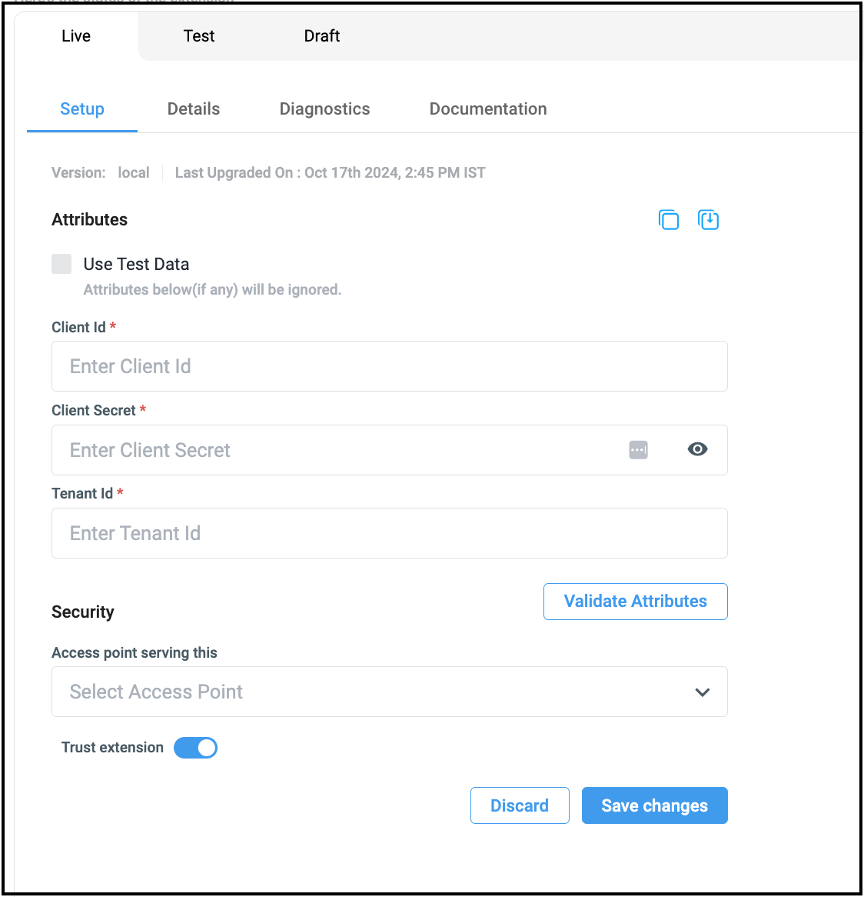

# Extension Configuration

## Overview

The Azure Authentication Extension requires proper configuration to establish secure communication with Microsoft Entra ID (formerly Azure Active Directory). This configuration enables OAuth 2.0 authentication flows and user account provisioning within your Krista workspace.

## Configuration Parameters

| Parameter | Type | Required | Description | Example |
|-----------|------|----------|-------------|---------|
| Client ID | Text | Yes | OAuth 2.0 client identifier from Azure app registration | "12345678-1234-1234-1234-123456789abc" |
| Client Secret | Text (Secured) | Yes | OAuth 2.0 client secret from Azure app registration | "abc123~DEF456_GHI789-JKL012" |
| Tenant ID | Text | Yes | Azure tenant identifier (Directory ID) | "87654321-4321-4321-4321-210987654321" |
| Default Role | Text | No | Default role assigned to new users | "Krista Guest User" |

### Parameter Details

#### Client ID
- **Purpose**: Identifies your Azure application to Microsoft's authentication service
- **Format**: GUID (Globally Unique Identifier)
- **Location**: Found in Azure Portal > App registrations > Your app > Overview
- **Validation**: Must be a valid GUID format

#### Client Secret
- **Purpose**: Authenticates your application to Azure
- **Security**: Stored securely and encrypted
- **Expiration**: Client secrets have expiration dates set in Azure
- **Best Practice**: Rotate secrets before expiration

#### Tenant ID
- **Purpose**: Identifies your Azure tenant/directory
- **Format**: GUID (Globally Unique Identifier)
- **Location**: Found in Azure Portal > Microsoft Entra ID > Overview > Tenant ID
- **Scope**: Determines which users can authenticate

#### Default Role
- **Purpose**: Assigns a default role to newly provisioned users
- **Default Value**: "Krista Guest User"
- **Customization**: Can be changed to any valid role in your workspace
- **Impact**: Affects user permissions and access levels

## Step-by-Step Setup

### 1. Prerequisites
Before configuring the extension, ensure you have:
- [ ] Azure subscription with Entra ID access
- [ ] Workspace administrator privileges in Krista
- [ ] Completed Azure app registration (see [Creating Azure App](/pages/CreatingAzureApp.md))

### 2. Access Extension Configuration
1. Navigate to your Krista workspace
2. Go to **Extensions** section
3. Locate **Azure Authentication Extension**
4. Click **Configure** or **Settings**

### 3. Enter Configuration Parameters
1. **Client ID**: Enter the Application (client) ID from your Azure app registration
2. **Client Secret**: Enter the client secret value from Azure
3. **Tenant ID**: Enter the Directory (tenant) ID from Azure
4. **Default Role**: Specify the default role for new users (optional)



### 4. Enable Trust Extension
1. Locate the **Trust Extension** checkbox
2. ✅ **Enable** this option for enhanced security
3. This setting is **strongly recommended** for production environments

### 5. Validate Configuration
1. Click **Validate** or **Test Connection**
2. The system will verify your Azure credentials
3. Successful validation confirms proper setup
4. Address any validation errors before proceeding

## Authentication Type Selection

The Azure Authentication Extension uses **OAuth 2.0 with Authorization Code Grant** flow:

- **Authentication Method**: OAuth 2.0
- **Grant Type**: Authorization Code Grant
- **Token Types**: Access tokens and refresh tokens
- **User Context**: Delegated permissions (user authentication)

## Redirect URI Configuration

### Required Redirect URI
Your Azure app registration must include this exact redirect URI:

```
https://extension.us.krista.app/extension/api/authn/v3/oauth/callback
```

### Configuration Steps
1. In Azure Portal, navigate to your app registration
2. Go to **Authentication** section
3. Add the redirect URI under **Web** platform
4. Ensure the URI matches exactly (case-sensitive)
5. Save the configuration

> **⚠️ Important**: The redirect URI must match exactly, including the protocol (https) and path.

## Allow Retry Flag

The extension includes automatic retry mechanisms for:

- **Token Refresh**: Automatic refresh of expired access tokens
- **Authentication Failures**: Retry authentication on transient failures
- **API Calls**: Retry failed API calls to Microsoft Graph

### Retry Behavior
- **Access Token Expiration**: Automatically refreshed using refresh token
- **Refresh Token Expiration**: User re-authentication required
- **Network Failures**: Automatic retry with exponential backoff
- **Rate Limiting**: Respect Microsoft Graph rate limits

## Security Considerations

### 1. Credential Security
- **Client Secret**: Stored encrypted in Krista
- **Access Tokens**: Temporary and automatically refreshed
- **Refresh Tokens**: Securely stored and managed
- **Session Management**: Secure session handling

### 2. Trust Extension
> **🔒 Security Best Practice**: Always enable Trust Extension in production environments.

Benefits of Trust Extension:
- Enhanced security validation
- Additional encryption layers
- Improved audit logging
- Stricter access controls

### 3. Network Security
- **HTTPS Only**: All communication uses HTTPS
- **Certificate Validation**: SSL/TLS certificate validation
- **Secure Headers**: Proper security headers implemented

### 4. Access Control
- **Workspace Admin Rights**: Extension requires workspace admin privileges
- **Role-Based Access**: Users assigned appropriate roles
- **Principle of Least Privilege**: Minimal required permissions

## Troubleshooting

### Common Configuration Issues

#### Invalid Client ID
**Error Message**: "Invalid Client ID. Please verify your Azure app registration and ensure the Client ID is correct. You can find the Client ID in Azure Portal > App registrations > Your app > Overview."

**Symptoms**: Configuration validation fails with client ID error
**Common Causes**:
- Incorrect Client ID format (must be a valid GUID)
- Client ID copied from wrong Azure app registration
- Typos or extra characters in Client ID
- Using Application ID URI instead of Application (client) ID

**Resolution Steps**:
1. **Verify in Azure Portal**: Go to Azure Portal > App registrations > Your app > Overview
2. **Copy Application (client) ID**: Ensure you're copying the correct GUID format
3. **Check Format**: Client ID should be in format: `12345678-1234-1234-1234-123456789abc`
4. **Avoid Common Mistakes**: Don't use Object ID or Application ID URI
5. **Test Configuration**: Use the extension's validation feature to confirm

#### Invalid Client Secret
**Error Message**: "Invalid Client Secret. The secret may have expired or is incorrect. Please generate a new client secret in Azure Portal > App registrations > Your app > Certificates & secrets."

**Symptoms**: Authentication fails during configuration validation
**Common Causes**:
- Client secret has expired (secrets have expiration dates)
- Incorrect secret value copied
- Secret copied from wrong Azure app
- Using secret ID instead of secret value
- Secret was regenerated but extension not updated

**Resolution Steps**:
1. **Check Expiration**: Go to Azure Portal > App registrations > Your app > Certificates & secrets
2. **Verify Secret Status**: Look for expired secrets (marked with red warning)
3. **Generate New Secret**: Click "New client secret" if current one is expired
4. **Copy Secret Value**: Copy the VALUE (not the Secret ID) immediately after creation
5. **Update Extension**: Paste the new secret value in extension configuration
6. **Test Immediately**: Validate configuration to ensure secret works

> **⚠️ Important**: Secret values are only shown once during creation. If you lose it, you must create a new one.

#### Invalid Tenant ID
**Error Message**: "Invalid Tenant ID. Please verify your Azure directory ID is correct. You can find the Tenant ID in Azure Portal > Microsoft Entra ID > Overview."

**Symptoms**: Configuration fails with tenant-related errors
**Common Causes**:
- Incorrect Tenant ID format (must be a valid GUID)
- Using wrong Azure directory/tenant
- Typos or formatting errors in Tenant ID
- Using domain name instead of Tenant ID
- Copying from wrong location in Azure Portal

**Resolution Steps**:
1. **Navigate to Correct Location**: Go to Azure Portal > Microsoft Entra ID > Overview
2. **Find Tenant ID**: Look for "Tenant ID" (also called Directory ID)
3. **Verify Format**: Should be GUID format: `87654321-4321-4321-4321-210987654321`
4. **Check Directory**: Ensure you're in the correct Azure directory/tenant
5. **Avoid Common Mistakes**: Don't use domain name or subscription ID
6. **Validate Configuration**: Test the configuration after updating

#### Redirect URI Mismatch
**Symptoms**: "Redirect URI mismatch" during authentication
**Causes**:
- Missing redirect URI in Azure app
- Incorrect redirect URI format
- Case sensitivity issues

**Resolution**:
1. Add correct redirect URI to Azure app
2. Verify exact URI format
3. Check case sensitivity

### Validation Errors

#### Connection Test Failed
**Symptoms**: Validation fails with connection error
**Possible Causes**:
- Network connectivity issues
- Firewall blocking requests
- Azure service outage
- Incorrect configuration

**Resolution Steps**:
1. Check network connectivity
2. Verify firewall settings
3. Confirm Azure service status
4. Re-validate configuration parameters

#### Permission Denied
**Symptoms**: "Insufficient permissions" error
**Causes**:
- Missing required permissions in Azure app
- Admin consent not granted
- Incorrect permission configuration

**Resolution**:
1. Review Azure app permissions
2. Grant admin consent if required
3. Ensure User.Read permission is added

## See Also

- [Authentication](/pages/Authentication.md) - OAuth 2.0 flows and token management
- [Creating Azure App](/pages/CreatingAzureApp.md) - Azure Portal setup guide
- [Release Notes](/pages/ReleaseNotes.md) - Version history and updates
