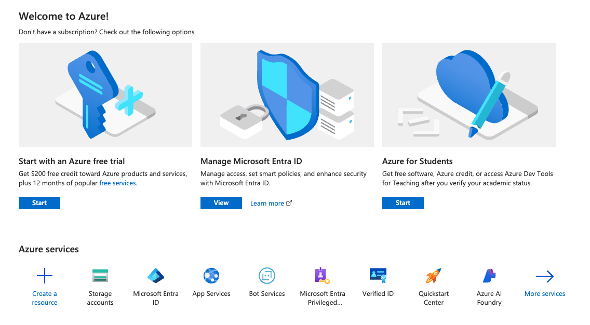
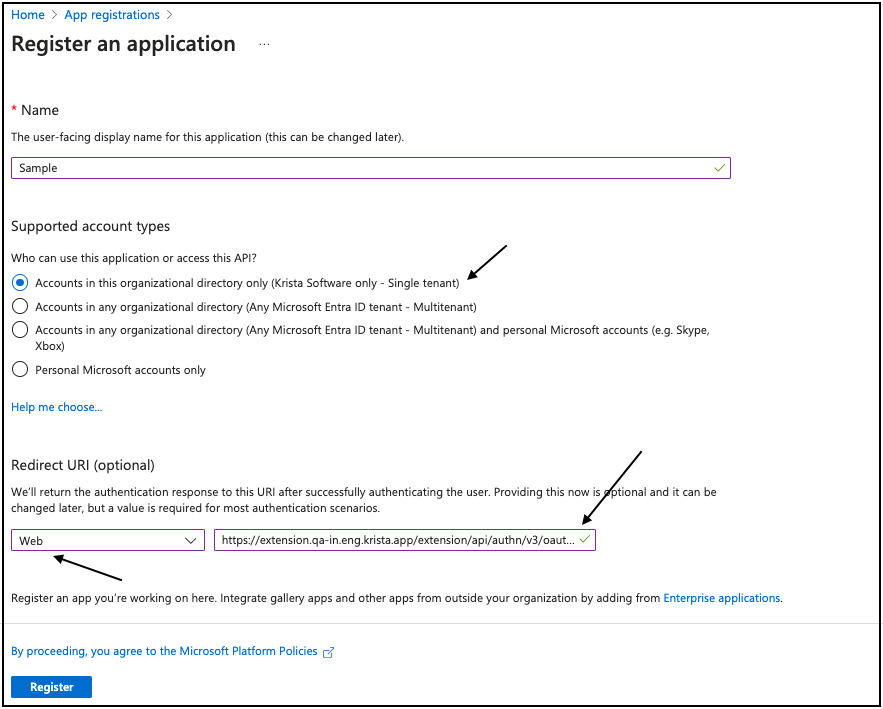
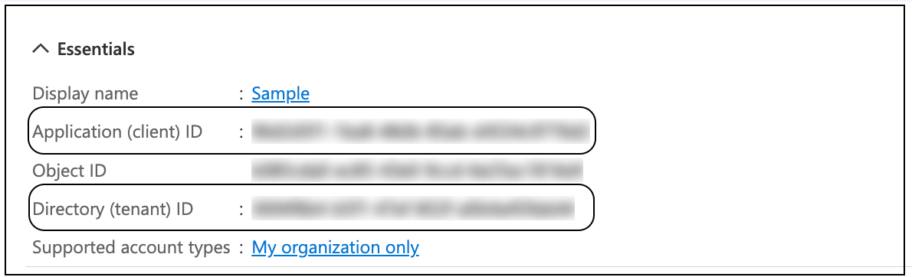
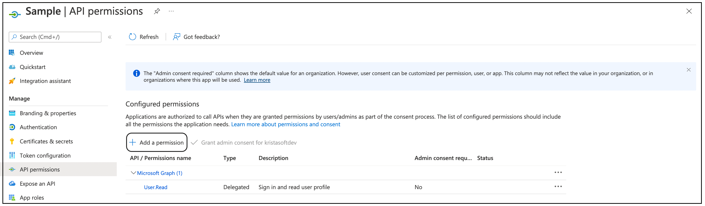

# Obtaining Credentials For Authentication

* For the Azure Extension, you would need to obtain Client ID, Tenant ID, and Client Secret from the Azure Portal.

### Steps to get Client ID, Tenant ID, and Client Secret

* Log in to the Azure portal. To see related information, [click here](https://portal.azure.com/).
  

* Under **Azure services**, click **Microsoft Entra ID**. If not found readily click **More services** to find Microsoft
  Entra ID.
  

* On the following Overview page, click **App registrations** under the **Manage** column menu.
  

* At the top of the page, click **New Registration**. Alternatively, open your pre-existing application.
  

* **Register an application** page is displayed. Enter the relevant details on this application page. Enter the **Name**
  that would be display name. Select the **Supported account types**. Out of the available options, select accounts in
  the single tenant only (first option).

* Under Redirect URI, select the Web platform and add the authorized redirect URI for your Azure extension. To do this, copy the Extension Base URL from the Invoker's Details tab and replace the routing ID in the URL with /authn/v3/oauth/callback.
For example, if the routing URL from the Details tab is https://extension.<your-Domain>/extension/api/FwoDdIazmBVeU4DRo0F_sdQ_e_e, where **FwoDdIazmBVeU4DRo0F_sdQ_e_e** is the routing ID, the updated redirect URI will be:
  https://extension.<your-domain>/extension/api/authn/v3/oauth/callback. For Example:  https://extension.us.krista.app/extension/api/authn/v3/oauth/callback. * Finally, click Register.

  

* After registration, in **Overview**, under **Essentials**, you will find the Client ID and Tenant ID.
  

* Click **API Permissions**. Under **Configured permissions**, click **Add a permission**.
  

* On the **Request API permissions** page, select **Microsoft Graph**.
  

* Select **Delegated Permissions**.
  

* Start typing permission name and select the following permissions after you see.
  * User.read

  

* Click **Certificates & secrets**, go to and click **New client secret**.
  

* On the **Add a client secret panel**, enter the **Description**, and set up the time span of expiry in the **Expires**
  field. Click **Add**.
  

* On the following page, you will see the Client Secret under **Value**.
  

* Save the Client ID, Tenant ID, and Client Secret for future reference.

* You must provide these values in your extension to proceed with the operations such as catalog requests and invoker
  request.
